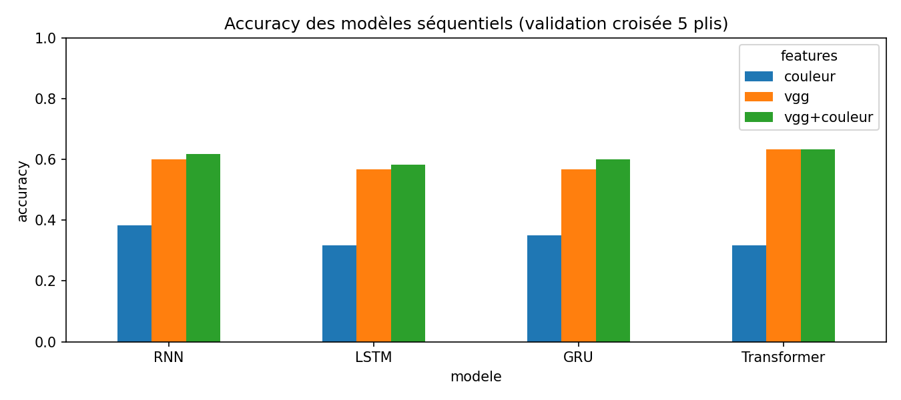
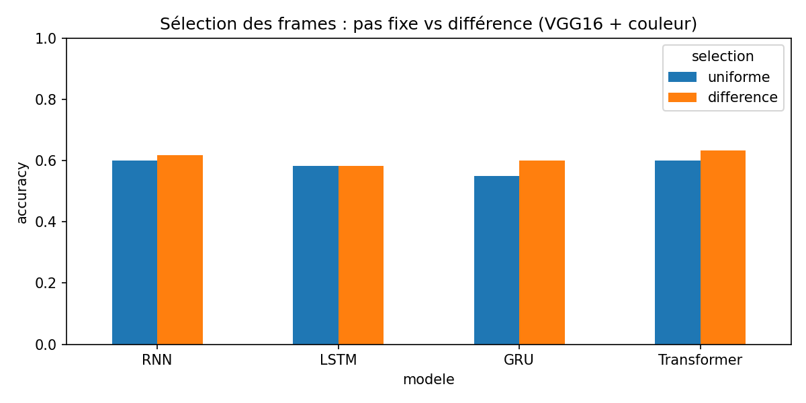

# Reconnaissance des émotions faciales dans les vidéos RAVDESS

Projet du module **Exploration intelligente des images par Deep Learning** (Pr. Abdelouahed Sabri),
Master **Web Intelligence et Sciences des Données (WISD)**, FSDM, Université Sidi Mohamed Ben Abdellah, Fès, 2026–2027.

**Auteur :** Yahia Khroufi

## Objectif

Reconnaître l'émotion d'une vidéo (8 classes : neutre, calme, joie, tristesse, colère, peur, dégoût, surprise)
à partir de la **suite de ses frames**, en comparant quatre modèles séquentiels : **RNN, LSTM, GRU et Transformer**.

## Pipeline

```
Vidéo .mp4
  → détection et recadrage du visage (Haar, OpenCV), 128 × 128
  → sélection des frames par différence (anti-redondance), T = 16
  → caractéristiques par frame : VGG16 pré-entraîné + GAP (512) + moments couleur (6)
  → séquence (16 × 518)
  → RNN | LSTM | GRU | Transformer → émotion
```

- **Sélection des frames :** une frame est gardée si sa différence moyenne avec la dernière frame gardée dépasse un seuil adaptatif (médiane des différences entre frames consécutives de la vidéo).
- **CNN :** VGG16 (ImageNet) gelé, sans la partie classification, avec GlobalAveragePooling.
- **Moments couleur :** moyenne et écart-type des canaux R, G, B.
- **Évaluation :** un seul acteur (Actor_01, 60 vidéos), séparation par vidéo, validation croisée stratifiée à 5 plis.

## Résultats

| Expérience | Accuracy | F1 (macro) |
|---|---|---|
| CNN VGG16, niveau frame | 0,582 | 0,545 |
| CNN VGG16, niveau vidéo (vote majoritaire) | **0,700** | 0,666 |
| Transformer (VGG16, sélection par différence) | 0,633 | 0,605 |
| RNN (VGG16 + couleur) | 0,617 | 0,589 |
| GRU (VGG16 + couleur) | 0,600 | 0,565 |
| LSTM (VGG16 + couleur) | 0,583 | 0,542 |
| Moments couleur seuls (meilleur : RNN) | 0,383 | 0,343 |

- La sélection par différence supprime environ **31 %** de frames redondantes et fait mieux ou aussi bien que le pas fixe pour les quatre modèles (jusqu'à +5 points pour le GRU).
- Sur ce jeu d'un seul acteur, le vote majoritaire du CNN reste au-dessus des modèles séquentiels : 48 vidéos d'apprentissage par pli ne suffisent pas à apprendre la dynamique de l'expression.





Le rapport complet est dans [`rapport/KHROUFI_Yahia_Projet_RAVDESS.pdf`](rapport/KHROUFI_Yahia_Projet_RAVDESS.pdf).

## Contenu du dépôt

```
notebooks/   RAVDESS_Projet_Yahia.ipynb   notebook Colab complet (avec les sorties)
rapport/     rapport PDF
resultats/   resultats.json, resultats_sequentiels.csv, figures/
```

## Utilisation

1. Télécharger la base RAVDESS (vidéos de parole) et placer les fichiers `.mp4` d'un acteur dans Google Drive.
2. Ouvrir `notebooks/RAVDESS_Projet_Yahia.ipynb` dans Google Colab avec un GPU (T4).
3. Adapter si besoin le chemin des données (section 2), puis **Exécution → Tout exécuter** (environ 20 minutes).

Les bibliothèques utilisées sont listées dans `requirements.txt` (elles sont déjà installées sur Colab).

## Données

Les vidéos ne sont pas incluses dans ce dépôt. Elles proviennent de **RAVDESS** :
Livingstone, S. R., & Russo, F. A. (2018). *The Ryerson Audio-Visual Database of Emotional Speech and Song (RAVDESS)*. PLoS ONE 13(5): e0196391.
Base disponible sur Zenodo, sous licence CC BY-NC-SA 4.0.

## Référence

Jallaglag, Sabri, Yahyaouy, Aarab (2026). *A two-stage deep learning approach for facial emotion recognition in RAVDESS videos*. Scientific Reports. doi:10.1038/s41598-026-60089-6
